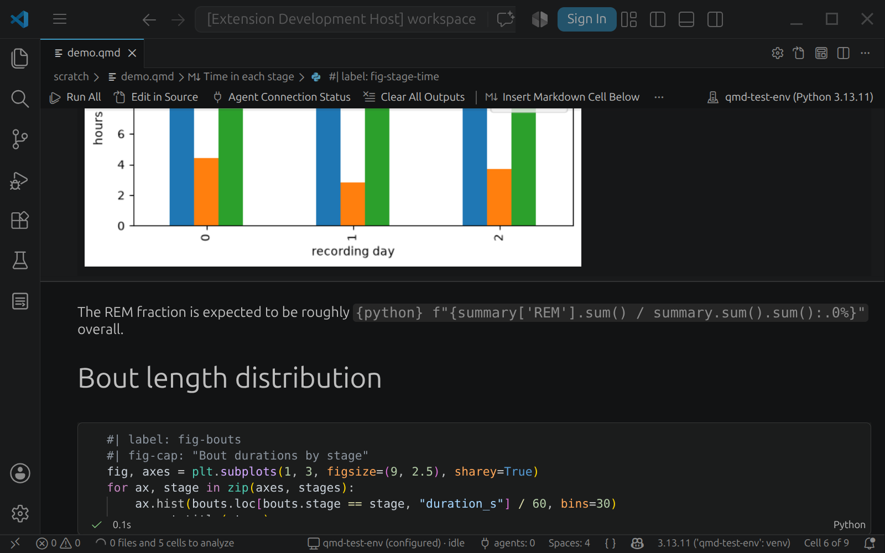
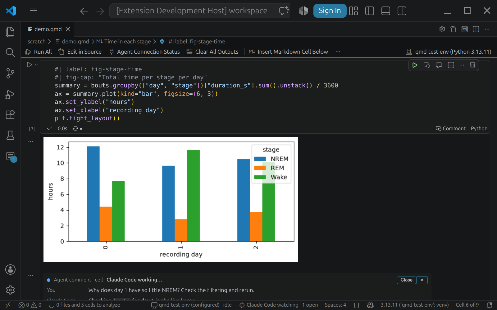

# QMD Notebook for VS Code

Open an ordinary Quarto `.qmd` file as a native, Python-focused VS Code notebook — real Pylance
cells, a persistent IPython kernel, inline plots/tables/tracebacks, vim-like cell navigation,
lossless `.qmd` round-trips, and a live bridge that lets Claude Code and Codex read, edit, execute
and inspect the same notebook and kernel you are looking at.

The `.qmd` on disk stays clean Quarto Markdown: no `.ipynb` JSON, no outputs, no IDs.

## Install

Each [GitHub Release](https://github.com/kortdriessen/qmd-notebook/releases) carries a
self-contained `qmd-notebook-<version>.vsix` (the MCP companion is bundled). With the GitHub CLI
logged in (`gh auth login`; the repository is private):

```bash
gh release download -R kortdriessen/qmd-notebook -p '*.vsix'
code --install-extension qmd-notebook-*.vsix --force   # plus ms-python.python + ms-python.vscode-pylance
```

or, from a clone, `scripts/install-latest.sh [vX.Y.Z]`. Under Remote SSH run it in a terminal on
the remote host (or use **Install in SSH: …** in the Extensions view). Then run **QMD Notebook:
Configure Claude Code / Codex MCP Access** once per machine (step 5 below); the Python
environments you use need `ipykernel`.

To build from source instead (Node ≥ 20): `npm install && scripts/package-vsix.sh` → `qmd-notebook.vsix`.

**Releasing:** bump the version (`npm version X.Y.Z --workspaces --include-workspace-root
--no-git-tag-version`, plus `VERSION` in `packages/mcp-server/src/cli.ts`), move the CHANGELOG
entries under `## X.Y.Z (date)`, commit, then `git tag vX.Y.Z && git push origin main vX.Y.Z`.
The Release workflow tests, packages and publishes the `.vsix` with the changelog section as
notes.

## Quick start

1. Right-click a `.qmd` → **Open With… → QMD Notebook**.
2. Pick a kernel (any Python environment with `ipykernel`; you are offered an install if it is
   missing). `Shift+Enter` runs a cell.
3. `Escape` → navigation mode: `j`/`k` move, `a`/`b` insert Python cells, `Enter` edits, `m`/`y`
   convert, `d d` deletes; `Alt+J`/`Alt+K` work from anywhere.
4. **QMD Notebook: Apply Recommended Appearance Settings** (optional, previewed) for compact
   bordered code cells.
5. **QMD Notebook: Configure Claude Code / Codex MCP Access**, restart the agent, then in the
   agent type `/mcp__qmd-notebook__focus_notebook analysis.qmd` (Claude Code) or
   `$focus-notebook analysis.qmd` (Codex). From then on, comment on cells (`Ctrl+Alt+A`) and the
   agent handles them in the thread. The extension automatically installs the Codex skill in
   `~/.agents/skills/focus-notebook/` when it activates, making it available across projects.
   See [docs/agent-setup.md](docs/agent-setup.md).

## What you get

| Area | Behaviour |
| --- | --- |
| File format | ```` ```{python} ```` chunks ⇄ Python cells; everything else ⇄ Markdown cells; `serialize(parse(x)) === x` byte for byte (LF/CRLF, BOM, no final newline, nested/tilde/long fences, YAML, callouts…). See [docs/qmd-roundtrip-contract.md](docs/qmd-roundtrip-contract.md). |
| Language features | Cells are real `python` documents: Pylance completion, hover and go-to-definition, including symbols defined in earlier cells. (Pylance does not publish diagnostics/squiggles for non-`.ipynb` notebooks; see Known limitations.) |
| Kernels | Kernel picker lists Python environments (Python extension API, `.venv`, configured paths) and Jupyter kernelspecs; `jupyter: python3` front matter pre-selects. One persistent kernel per notebook, kept alive for 10 min after closing (Edit in Source round trips keep state). |
| Outputs | stdout/stderr, tracebacks, `text/plain`, `text/html` (pandas), `image/png` (matplotlib), `image/svg+xml`, `application/json`, multiple outputs, `display_id` updates, `clear_output(wait)`, `input()`. Never saved into the file. |
| Execution | `Shift+Enter` run & advance (stays on a failing cell), `Ctrl+Enter` run, `Alt+Enter` run & insert, run above/all, interrupt, restart, shutdown, `#| eval: false` skipped unless **Force Run Cell**. |
| Source view | **Edit in Source** (`Ctrl+Alt+S`) saves, closes the notebook view and opens the text editor at the selected cell; **Reopen as Notebook** returns to the cell under the cursor with the kernel intact. |
| Agents | `qmd-notebook-mcp` companion: `list_open_notebooks`, `get_active_context`, `read_notebook/cell/output`, `replace_cell_source`, `insert/delete/move_cell`, `execute_cell(s)`, `execute_scratch`, `list_variables`, `summarize_variable`, kernel control, request threads. Optimistic concurrency (version + source hash) rejects stale edits. |
| Comments | Focus an agent on the notebook once (`/mcp__qmd-notebook__focus_notebook analysis.qmd` in Claude Code, `$focus-notebook` in Codex); then comment on a selection, cell or output (`Ctrl+Alt+A` / `Ctrl+Alt+O` / cell toolbar): a compose box appears under the cell and the thread stays there. The watching agent receives it, posts its plan and reply into the thread, and the cell shows `●`/`○` dots for open/resolved comments. Threads are transient outputs and never enter the `.qmd`. |

## Repository

```
packages/shared            protocol types, Zod schemas, ids
packages/vscode-extension  the extension (+ python/qmd_kernel_host.py kernel helper)
packages/mcp-server        qmd-notebook-mcp companion (also bundled into the extension)
fixtures/qmd               round-trip corpus
docs/                      architecture, round-trip contract, research decisions, agent setup
scripts/                   package-vsix.sh, smoke-test.sh
```

Commands: `npm run build`, `npm test` (unit), `npm run test:kernel -w packages/vscode-extension`
(real kernel; needs `QMD_TEST_PYTHON` with ipykernel/pandas/matplotlib, default
`~/qmd-test-env/bin/python`), `npm run test:vscode -w packages/vscode-extension` (launches the
locally installed VS Code with a private profile), `scripts/smoke-test.sh` (everything).





## Verification (2026-09-02, VS Code 1.130.0, Python 3.13, ipykernel 7.3)

- Parser/emitter: 44 node tests — 26 fixtures byte-identical, golden edit cases (edit/insert/delete/move/convert, LF/CRLF, fence conventions), 1000 random documents.
- Real kernel: 17 cases (state persistence, streams, PNG/HTML/SVG/JSON, errors, display
  updates, clear_output, stdin, interrupt, queued-cell cancellation, scratch execution, timeouts,
  variable inspection, restart, crash detection).
- VS Code integration (36 passing): serializer/save/insert/move/convert/reload, Pylance spike
  (completion, hover, definition across cells; diagnostics documented as a Pylance limitation),
  execution through the native run commands,
  navigation commands and keybinding guards, source toggle with kernel retention, and the agent
  bridge through the real MCP companion (tool surface, active context with selection, stale-edit
  rejection, undo, insert/move/delete, execute + image output, kernel inspection, request
  lifecycle, auth failure, wrong-workspace rejection, `doctor`).
- Packaged VSIX: installed into a clean VS Code profile (`scripts/vsix-smoke.sh`), a `.qmd` opens
  directly as a QMD Notebook, the extension log shows the bridge and kernel discovery starting
  (`docs/screenshot-packaged-vsix.png`).
- Real agents (`QMD_E2E_AGENTS=claude,codex`, `test/suite/agents.e2e.test.ts`): each CLI is asked
  to inspect a live variable, edit a selected cell with the version/hash preconditions, execute it
  and report the output; and, separately, to *focus* the notebook and resolve an in-editor comment
  (assign → wait_for_comments → edit → run → reply → release). The tests check the live cell, the
  new output, the thread state, and that the `.qmd` on disk was not touched. Results for Claude
  Code 2.1.258 and Codex 0.149.1 are in `docs/agent-setup.md`.

## Known limitations

- **Pylance diagnostics (squiggles) are not shown in QMD cells.** Pylance 2026.3.1 publishes
  cell diagnostics only for `.ipynb` notebooks (its server identifies notebook files by that
  extension); completion, hover, definition and cross-cell analysis work. The integration test
  reproduces this side by side with an `.ipynb`. Remediation: a Pylance issue requesting that
  notebook diagnostics follow the LSP `notebookSelector`; details in
  [docs/research-decisions.md](docs/research-decisions.md).
- **Remote SSH** is supported by design (`extensionKind: workspace`, kernel and bridge on the
  remote host) but has not yet been exercised on a real remote host. Remediation plan: run
  `scripts/smoke-test.sh` on the remote and `qmd-notebook-mcp doctor` from a remote integrated
  terminal; the only expected difference is the runtime directory location.
- No documented API exists to inject text into the Claude Code or Codex composer, so "Ask Agent"
  ends with paste + Enter (the handoff is on the clipboard and the composer is focused).
- VS Code exposes no "focused output" to extensions; output selection uses a Quick Pick when a
  cell has several outputs.
- Styling is limited to what stable APIs allow: theme colours and notebook settings (applied only
  through the previewed command), cell status-bar items, toolbar placement. No rounded corners.
- ipywidgets and Plotly are not handled specially (they render through VS Code's built-in
  renderers where possible); output persistence across reopen is not implemented (setting reserved).
- The Ask Agent thread UI is a side view + cell status item, not an in-cell thread.
