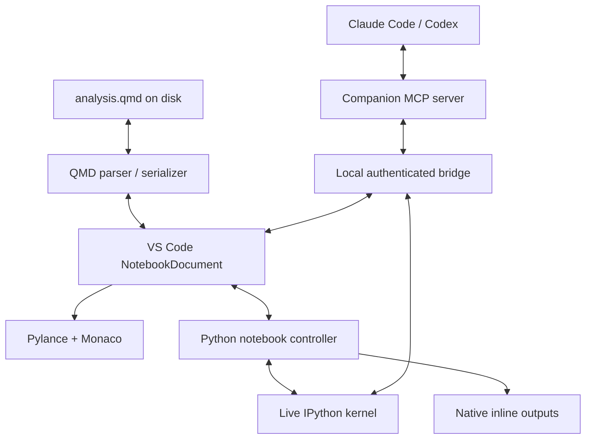

# QMD Notebook for VS Code

## Product and implementation specification

**Audience:** A highly capable implementation agent (Claude Code, Codex, or equivalent) working on a Linux workstation in a real VS Code development environment.

**Document status:** Authoritative product specification and implementation plan. Where this document explicitly calls for a research spike or prototype, run the experiment and record the evidence before choosing the implementation. Do not silently replace a required behavior with an approximation.

**Working product name:** `QMD Notebook`

---

## 1. Mission

Build a VS Code extension that opens an ordinary Quarto `.qmd` file as a polished, Python-focused native VS Code notebook while keeping the file on disk as clean, human-readable Quarto Markdown.

The desired experience is:

1. Right-click a `.qmd` file and choose **Open With → QMD Notebook**.
2. Executable fenced `{python}` chunks appear as native VS Code code cells.
3. All intervening Quarto/Markdown content appears as native Markdown cells.
4. Python cells retain ordinary VS Code/Pylance language intelligence.
5. A normal kernel picker selects a Python/IPython kernel.
6. `Shift+Enter` executes a cell in a persistent kernel shared by the whole document.
7. Matplotlib figures, pandas dataframes, stdout/stderr, rich HTML, and tracebacks render immediately below the cell.
8. Saving reconstructs a clean `.qmd`, with no `.ipynb` JSON and no agent metadata inserted into the source.
9. The user can move quickly between a command-like cell navigation mode and ordinary cell editing.
10. In navigation mode, plain `j`/`k` select the next/previous cell and `a`/`b` insert a cell above/below.
11. Code cells look like distinct but restrained containers, not loose source text and not oversized cards.
12. **Edit in Source** immediately opens the same file as an ordinary `.qmd` text document when exact source editing is needed.
13. Claude Code and Codex can connect to the live notebook, inspect its current kernel state, edit the same in-memory cells the user sees, execute edited cells, and inspect the resulting output.
14. The user can attach a prompt/comment to selected text, a cell, or an output/plot with context captured automatically.

This is not a new notebook file format. It is a QMD-to-VS-Code-Notebook adapter, execution layer, notebook UX layer, and agent bridge.

---

## 2. User and workflow assumptions

Optimize for this actual use case:

- Linux workstation, usually local VS Code or VS Code Remote SSH.
- Python-only scientific computing.
- Heavy use of pandas, NumPy, SciPy, Matplotlib, seaborn, scikit-learn, and domain-specific scientific packages.
- Stateful, exploratory work in an IPython/Jupyter kernel.
- `.qmd` is preferred over `.ipynb` because it is readable, diffable, Quarto-native, and appropriate for analysis narratives and reports.
- Pylance, editor completions, hover, diagnostics, go-to-definition, and normal Monaco editing are important.
- Claude Code and Codex may be used from a VS Code sidebar or from a CLI in the VS Code integrated terminal.
- The user wants very low-friction cell navigation and agent collaboration, not a reproduction of every feature in JupyterLab.

The implementation should feel excellent for one technically sophisticated scientist before it attempts to be a general-purpose Marketplace product.

---

## 3. Non-goals and intentionally excluded scope

The following are not V1 goals:

- R, Julia, Observable JS, Bash kernels, or multi-language notebooks.
- Reimplementing the Quarto visual editor.
- Full semantic parsing or rendering of all Pandoc/Quarto extensions.
- WYSIWYG Quarto layout.
- Reproducing Quarto's final HTML/PDF renderer inside the notebook editor.
- Supporting `.ipynb` as a persistence format.
- Persisting notebook outputs inside `.qmd`.
- Full ipywidgets support in the first usable build.
- Real-time multi-human collaboration over a network.
- Silent arbitrary kernel access by remote processes.
- Marketplace-grade compatibility with every VS Code fork before the core VS Code workflow is solid.

Do not spend time generalizing to other languages until every P0 acceptance criterion in this document passes for Python.

---

## 4. Product principles

### 4.1 The `.qmd` file is the durable source of truth

The file must remain valid Quarto Markdown that can be rendered by the ordinary Quarto CLI and edited without this extension.

### 4.2 The open `NotebookDocument` is the live collaborative source of truth

While the QMD Notebook editor is open, human edits, agent edits, cell selection, execution, and outputs must operate through VS Code's live notebook model. Agents must never modify the `.qmd` file behind VS Code's back and wait for a reload.

### 4.3 The kernel is authoritative for runtime state

Variables, imports, fitted models, open datasets, and IPython state live in the selected running kernel. Agents should inspect that kernel instead of trying to reconstruct state by rerunning the entire file in a separate Python process.

### 4.4 Round-trip fidelity outranks clever parsing

Recognize executable Python fences conservatively. Preserve everything else as opaque Markdown content. An unsupported Quarto construct should remain intact, not be “normalized” into a subtly different document.

### 4.5 Native VS Code editors are mandatory

Do not build the main editor as a monolithic WebView. Python cells must be real notebook cell text documents so Pylance and ordinary VS Code language features work.

### 4.6 Agent collaboration must use notebook-aware operations

Agents edit cells by runtime cell identity with optimistic version checks. They do not edit raw `.qmd` offsets or serialized notebook JSON.

---

## 5. Desired user experience

### 5.1 Opening and switching views

Contribute a custom notebook editor with display name **QMD Notebook** for `*.qmd`.

Required commands:

- `QMD Notebook: Open as Notebook`
- `QMD Notebook: Edit in Source`
- `QMD Notebook: Reopen as Notebook`
- `QMD Notebook: Reload from Disk`

Do not initially force QMD Notebook to become the default editor for every `.qmd`. Let the user opt in with **Open With**, then allow VS Code's normal “Configure default editor” behavior.

`Edit in Source` must:

1. save or explicitly resolve unsaved notebook changes;
2. open the same URI with the default text editor;
3. place the cursor near the source span corresponding to the selected notebook cell;
4. keep the live kernel available for a configurable grace period so reopening as a notebook can reconnect to the same state;
5. prevent two unsynchronized writable views from silently overwriting one another.

If VS Code permits the notebook and text view to remain open simultaneously, implement explicit external-change detection and a safe reload/compare flow. For V1 it is acceptable—and likely safer—to close the writable notebook view before opening the source view, while keeping the kernel session alive.

### 5.2 Cell presentation

Code cells should look like defined containers:

- subtle one-pixel border;
- slightly differentiated editor background;
- compact padding;
- restrained selected-cell accent, preferably a stronger left edge plus border color;
- small Python label and execution status/count;
- compact run control;
- outputs visually associated with the cell container;
- no giant empty margins or oversized card chrome.

Use the native notebook UI plus supported notebook decoration/theme APIs. Do not inject unsupported CSS into VS Code. If the exact desired rounded-box styling is impossible through stable APIs, retain the native editor and get as close as possible with supported decorations, colors, toolbar placement, and notebook settings.

Markdown cells should be visually quieter than code cells. When not being edited, they should render as Markdown. When entered, they should become ordinary Monaco-backed Markdown editors.

### 5.3 Command/navigation mode versus edit mode

The interaction model should be explicit and discoverable.

**Edit mode**

- A cell's editor has text focus.
- Normal typing, Pylance, selection, undo, and editor shortcuts work.
- `Escape` exits to navigation mode and selects the current cell.
- `Shift+Enter` executes the current Python cell and advances to the next cell.
- `Ctrl+Enter` executes and stays on the current cell.
- `Alt+Enter` executes and inserts a Python cell below.

**Navigation mode**

- The notebook cell list, not a text editor, has focus.
- `Enter` focuses the selected cell editor and restores a sensible cursor position.
- `j` selects the next cell.
- `k` selects the previous cell.
- `a` inserts a Python code cell above.
- `b` inserts a Python code cell below.
- `m` converts the selected cell to Markdown.
- `y` converts the selected cell to Python code.
- `d d` may delete the selected cell only if a reliable two-key chord can be implemented without harming normal editing; otherwise use a safer explicit delete shortcut and command.

**Always-available navigation**

- `Alt+J` selects the next cell and enters/remains in navigation mode.
- `Alt+K` selects the previous cell and enters/remains in navigation mode.

All single-letter bindings must be guarded by precise VS Code `when` clauses so they never steal letters while a cell editor, input box, find widget, terminal, or other text input has focus. Scope them to the QMD Notebook view type, not every VS Code notebook.

Display a subtle status indicator such as `QMD: NAV` / `QMD: EDIT`, at least during early builds, so focus bugs can be diagnosed.

### 5.4 Cell insertion behavior

`a` and `b` insert Python code cells by default because this product is Python-focused. Markdown insertion remains available via `m`, a toolbar button, and a command.

When adding a cell:

- insert syntactically valid QMD on save;
- use a conventional executable fence (` ```{python}`) with the document's existing newline style;
- place one blank line around a newly inserted cell unless neighboring raw content already provides appropriate separation;
- focus the new cell in edit mode;
- never add hidden IDs or metadata comments to the `.qmd`.

### 5.5 Execution and outputs

The user should see the same basic execution affordances expected in a VS Code Jupyter notebook:

- kernel picker;
- persistent shared kernel per notebook;
- busy/idle status;
- interrupt;
- restart;
- run cell;
- run all above;
- run all;
- clear cell output;
- clear all outputs;
- execution count where the backend supplies it.

Minimum required output support:

- `text/plain`;
- stdout and stderr streams;
- Python errors and tracebacks;
- `text/html` for pandas rich display;
- `image/png` for Matplotlib;
- `image/svg+xml`;
- `application/json` where applicable;
- multiple display outputs from one cell;
- `display_data`, `execute_result`, `update_display_data`, and `clear_output` semantics;
- output replacement by `display_id` where feasible.

Matplotlib, pandas display, stdout, and exceptions are P0. Plotly and ipywidgets are later phases unless they work nearly for free through delegated Jupyter renderers.

---

## 6. High-level architecture



Implement the system as four separable layers:

1. **QMD document adapter** — conservative parsing, notebook cell construction, lossless serialization.
2. **Notebook UX** — commands, keybindings, decorations, source toggle, cell operations.
3. **Kernel execution** — kernel discovery/selection, persistent sessions, execution, output translation.
4. **Agent bridge** — authenticated local IPC, MCP tools, contextual prompt/comment threads, concurrency control.

Do not entangle parsing with kernel execution or agent transport. Each layer must be independently testable.

---

## 7. Repository and package layout

A reasonable monorepo layout is:

```text
qmd-notebook/
├── package.json
├── package-lock.json                 # or pnpm-lock.yaml; choose one
├── tsconfig.base.json
├── README.md
├── LICENSE
├── CHANGELOG.md
├── docs/
│   ├── architecture.md
│   ├── agent-setup.md
│   ├── qmd-roundtrip-contract.md
│   └── research-decisions.md
├── packages/
│   ├── vscode-extension/
│   │   ├── package.json
│   │   ├── src/
│   │   │   ├── extension.ts
│   │   │   ├── notebook/
│   │   │   │   ├── serializer.ts
│   │   │   │   ├── parser.ts
│   │   │   │   ├── emitter.ts
│   │   │   │   ├── model.ts
│   │   │   │   └── sourceMap.ts
│   │   │   ├── execution/
│   │   │   │   ├── controller.ts
│   │   │   │   ├── kernelProvider.ts
│   │   │   │   ├── outputTranslator.ts
│   │   │   │   └── sessionRegistry.ts
│   │   │   ├── ux/
│   │   │   │   ├── commands.ts
│   │   │   │   ├── keybindings.ts
│   │   │   │   ├── decorations.ts
│   │   │   │   └── sourceToggle.ts
│   │   │   └── agent/
│   │   │       ├── ipcServer.ts
│   │   │       ├── notebookService.ts
│   │   │       ├── requestThreads.ts
│   │   │       └── contextCapture.ts
│   │   └── test/
│   ├── mcp-server/
│   │   ├── package.json
│   │   ├── src/
│   │   │   ├── index.ts
│   │   │   ├── discovery.ts
│   │   │   ├── ipcClient.ts
│   │   │   ├── tools.ts
│   │   │   └── schemas.ts
│   │   └── test/
│   └── shared/
│       ├── src/
│       │   ├── protocol.ts
│       │   ├── ids.ts
│       │   └── errors.ts
│       └── test/
├── fixtures/
│   ├── qmd/
│   ├── golden/
│   └── outputs/
└── scripts/
    ├── package-vsix.*
    └── smoke-test.*
```

TypeScript is the default implementation language. Use strict TypeScript, ESLint, formatting, and schema validation (for example Zod) at IPC/MCP boundaries.

Avoid adding a Python backend unless the selected kernel integration requires it. If a Python helper becomes necessary, isolate it behind a versioned JSON-RPC boundary and document exactly which Python environment owns it.

---

## 8. Mandatory research spikes before full implementation

Create `docs/research-decisions.md` and record the VS Code version, extension versions, commands run, prototype code, observed behavior, and chosen approach for each spike.

### Spike A: custom notebook + Pylance

Build the smallest possible custom `NotebookSerializer` for `.qmd` with one Python cell and one Markdown cell.

Verify:

- Python cell has `languageId = "python"`.
- Pylance completion works.
- hover and diagnostics work.
- go-to-definition into workspace modules works.
- symbols defined in earlier notebook cells influence later-cell analysis as much as they do in ordinary VS Code Jupyter notebooks.
- Remote SSH behavior is acceptable.

If basic Pylance works but cross-cell analysis differs from `.ipynb`, determine whether notebook type metadata or an API contract can fix it. Document any unavoidable difference.

### Spike B: kernel integration decision

Prefer reusing Microsoft's installed VS Code Jupyter extension if there is a stable, supported API that can:

- enumerate usable Jupyter kernels/Python environments;
- associate a selected kernel with this custom notebook type;
- execute code in a persistent session;
- surface IOPub messages or translated `NotebookCellOutput` objects;
- interrupt/restart/dispose the session;
- work under Remote SSH;
- avoid depending on private extension internals.

Research the current official Jupyter extension API, current extension exports, and Microsoft's kernel execution samples. Do not rely only on old wiki pages or blog posts. Prototype actual execution in the custom QMD notebook.

Choose the first viable option in this order:

1. **Supported Microsoft Jupyter extension API** with a thin QMD controller adapter.
2. **Supported VS Code command/controller delegation** if it genuinely uses the selected Jupyter kernel and does not depend on brittle command names.
3. **Direct Jupyter protocol implementation** using stable Jupyter libraries/services, with kernelspec discovery and a QMD-owned `NotebookController`.
4. **Small Python `jupyter_client` sidecar**, launched in a clearly selected environment, only if the Node/Jupyter route is materially worse.

Do not import or copy private modules from the Microsoft Jupyter extension. Do not make the project depend on undocumented internal object shapes.

The spike is complete only when this sequence works:

```python
x = 41
```

followed in a different cell by:

```python
x + 1
```

with `42` rendered below the second cell, followed by a Matplotlib PNG and pandas HTML table.

### Spike C: native notebook styling limits

Determine what can be achieved through stable APIs and contribution points:

- notebook editor decorations;
- selected cell border/background;
- code cell status bar items;
- cell toolbar placement;
- output container styling;
- theme color contributions;
- compact cell margins.

Produce a screenshot or short recording of the best supported native approach. Do not switch to a WebView merely to obtain rounded corners.

### Spike D: contextual prompt UI

Test the best stable way to attach an ephemeral prompt thread to:

- a code-cell text selection;
- a Markdown-cell text selection;
- a whole cell;
- a specific notebook output item.

Investigate, in this order:

1. notebook cell/output toolbar contributions plus a compact prompt input;
2. transient custom notebook outputs rendered by a small renderer;
3. notebook cell status bar action plus VS Code input box;
4. a narrow side panel synchronized to the selected cell/output.

The input must not become QMD source and must not dirty the document solely because a prompt was composed.

### Spike E: agent-surface handoff

At implementation time, inspect the current **documented** integration surfaces for:

- Claude Code VS Code extension and CLI;
- Codex VS Code extension and CLI;
- MCP server configuration;
- VS Code commands that may open/focus an agent composer or attach current selection.

Do not call undocumented extension internals merely because a command happens to exist. A direct sidebar “submit prompt” API may not exist. The guaranteed architecture must therefore be MCP-based and work from the CLI; sidebar conveniences should be adapters layered on top.

---

## 9. QMD parser specification

### 9.1 Conservative segmentation

Implement a line-aware state machine, not a single regular expression.

The parser should identify only top-level executable Python fenced blocks. Everything else remains opaque Markdown.

Recognize at minimum:

````qmd
```{python}
code()
```
````

Also research and correctly handle valid Pandoc/Quarto fence forms that can occur in real files, including:

- backtick and tilde fences;
- opening fences longer than three characters;
- closing fence length rules;
- indentation allowed by Pandoc Markdown;
- attributes after `python` where Quarto permits them;
- braces and quoted text on the opener;
- nested fenced examples protected by longer outer fences;
- literal examples such as ````{{python}}```` that must not execute;
- line endings `LF` and `CRLF`;
- a file with no terminal newline;
- unmatched/incomplete fences while the user is editing.

Only `{python}` executable chunks become code cells in V1. Ordinary fenced `python` blocks without executable braces remain Markdown content. R, Julia, Bash, Mermaid, raw blocks, and unknown engines remain Markdown content unchanged.

### 9.2 YAML front matter

Treat top-of-document YAML front matter as part of the first Markdown cell in the first implementation unless a dedicated raw/YAML cell proves clearly better without round-trip risk.

Parse enough front matter non-destructively to read hints such as:

- `jupyter: python3`;
- project/document execution settings;
- default engine metadata.

Do not reserialize YAML through a generic YAML library. That would destroy comments, quote style, anchors, ordering, and whitespace. Preserve it as raw text.

### 9.3 Code cell contents

The visible/editable code cell source should include Quarto cell option comments because they are valid Python comments and need to remain editable:

```python
#| label: fig-example
#| fig-cap: "Example figure"
#| echo: false

plt.plot(x, y)
```

Parse option comments only to support behavior and UI hints. Preserve their exact source text.

At minimum recognize `#| eval: false`. Normal “run” should skip such a cell with a clear status; provide `QMD Notebook: Force Run Cell` for deliberate interactive execution. Other Quarto options generally affect final render, not interactive notebook display.

### 9.4 Cell granularity

The default model is alternating opaque Markdown regions and executable Python cells:

```text
Markdown region
Python chunk
Markdown region
Python chunk
Markdown region
```

Do not split Markdown automatically at every heading or blank line in V1. Fewer, larger Markdown cells give cleaner lossless serialization. Later, explicit commands can split or merge Markdown cells.

### 9.5 Malformed documents

Never destroy source because parsing is uncertain.

For an unmatched potential Python fence:

- represent the uncertain remainder as Markdown;
- display a diagnostic describing the unmatched fence;
- disable destructive cell restructuring if serialization would be ambiguous;
- continue allowing **Edit in Source**.

---

## 10. Lossless serialization contract

This subsystem deserves unusually strong tests.

### 10.1 Required invariant

For every supported and unsupported valid QMD fixture:

```text
serialize(parse(originalBytes)) === originalBytes
```

when the user has made no notebook edits.

Byte-for-byte identity includes newline style, terminal newline, fence characters/length, whitespace, YAML formatting, and all opaque Quarto syntax.

### 10.2 Segment ownership model

Use an internal segment model that can reconstruct exact bytes without guessing. One workable design is:

```ts
type QmdSegment =
  | {
      kind: "markdown";
      runtimeCellId: string;
      originalText: string;
      currentText: string;
    }
  | {
      kind: "python";
      runtimeCellId: string;
      opener: string;
      originalBody: string;
      currentBody: string;
      closer: string;
      sourceSpan: SourceSpan;
    };
```

The exact representation may differ, but delimiters and trivia must be preserved separately from editable code.

Do not put raw delimiters in the visible Python editor. Do keep them in cell metadata/internal document state for emission.

### 10.3 Runtime cell IDs

Agents require stable identities within an open session. Assign UUIDs when parsing and retain them across ordinary cell edits, movement, and execution.

Do not insert UUID comments into QMD. Persistence across a full close/reopen is desirable but not worth source pollution. If needed, use extension workspace storage and conservative fingerprint matching based on document URI, segment kind, neighboring anchors, and source hashes. Never use a fingerprint match to overwrite a cell without also checking the current document version.

### 10.4 Insert/delete/move rules

Notebook cell structure can change, so define deterministic emission:

- existing cells retain their original fence/trivia where possible;
- a new Python cell uses the document's predominant fence and newline conventions;
- a new Markdown cell is emitted as its literal content;
- extension-provided insert commands establish appropriate blank-line separation;
- deletion removes exactly the selected logical segment and only separator whitespace owned by that segment;
- movement moves a complete segment including its fence;
- ambiguous merges should preserve extra blank lines rather than remove meaningful source.

Avoid storing separator whitespace in two adjacent cells. Give every byte exactly one owner.

### 10.5 Serialization and outputs

Notebook outputs and execution counts are transient and are never serialized into `.qmd`.

If output persistence across reopen is implemented later, store it in extension storage keyed by document URI, runtime/fingerprint cell identity, source hash, kernel identity, and execution timestamp. Mark restored output as potentially stale. Enforce a configurable size limit and LRU cleanup. Never create repository sidecar files by default.

### 10.6 Source maps

Maintain mappings between notebook cells and QMD byte/line spans. Use them for:

- **Edit in Source** cursor placement;
- diagnostics;
- agent context references;
- conflict/error messages;
- tests that edits touch only the intended QMD region.

---

## 11. Kernel execution design

### 11.1 Controller contract

The execution layer must expose an internal interface independent of its backend:

```ts
interface QmdKernelSession {
  readonly sessionId: string;
  readonly kernelDisplayName: string;
  readonly status: "starting" | "idle" | "busy" | "restarting" | "dead";

  executeCell(cell: CellExecutionRequest): AsyncIterable<KernelEvent>;
  executeScratch(code: string, options?: ScratchOptions): AsyncIterable<KernelEvent>;
  interrupt(): Promise<void>;
  restart(): Promise<void>;
  dispose(): Promise<void>;
}
```

The `NotebookController` adapts this interface to VS Code `NotebookCellExecution` and `NotebookCellOutput` objects.

### 11.2 Session lifecycle

- One selected persistent kernel session per open QMD notebook by default.
- Multiple QMD documents may intentionally share a kernel only through an explicit future command, not accidentally.
- Retain a session for a configurable grace period when switching briefly to source view.
- Dispose sessions when the notebook closes permanently, the workspace closes, or the user chooses shutdown.
- Surface kernel death and reconnect/restart choices clearly.
- Do not silently rerun all cells after restart.

### 11.3 Kernel selection

Match normal VS Code expectations as closely as the chosen backend permits.

Sources may include:

- installed Jupyter kernelspecs;
- the active Python interpreter;
- `.venv`, Conda, and uv-managed environments discoverable through supported Python/Jupyter APIs;
- a `jupyter:` front-matter hint.

Remember the selected kernel for a document/workspace without writing it into QMD unless the user explicitly chooses to update front matter.

Remote SSH requirement: kernel discovery and execution must occur on the remote extension host when the workspace is remote. Do not accidentally launch the kernel on the local UI machine.

### 11.4 Execution semantics

- Send the exact visible cell source, including harmless `#|` comments, to IPython.
- Preserve ordering and execution count.
- Support cancellation/interrupt.
- Do not execute Markdown cells.
- `Shift+Enter` advances even if a cell succeeds; on error, default to staying on the failing cell unless user testing strongly favors standard Jupyter behavior.
- Queue sequential cell execution; do not concurrently execute two cells in the same kernel.
- Agent scratch execution uses the same queue and same kernel.
- Clearly distinguish scratch/agent execution from document cell execution in logs and status.

### 11.5 Output translation

Correctly translate Jupyter messages:

- `stream` → append/merge text output without losing stdout/stderr identity;
- `execute_result` → rich MIME bundle plus execution count;
- `display_data` → rich MIME bundle;
- `update_display_data` → update the previous display by `display_id`;
- `error` → VS Code error output preserving traceback structure;
- `clear_output(wait)` → correct deferred/immediate clearing;
- `status` → busy/idle state;
- `execute_input` → execution count if available.

Sanitize or delegate HTML/SVG rendering according to VS Code security expectations. Do not enable arbitrary scripts in HTML outputs by default.

### 11.6 Scratch execution for agents

Agents need to inspect live variables without adding junk cells. Implement `executeScratch` against the same kernel.

Scratch execution:

- does not insert or modify a notebook cell;
- returns bounded output to the agent bridge;
- is visibly indicated in a small kernel activity/status area so it is not covert;
- supports timeout and interrupt;
- may mutate kernel state, so tool documentation must say so explicitly;
- should offer higher-level safe helpers for common inspection to reduce arbitrary code.

Add structured helper operations such as:

- list variables with type and approximate size;
- summarize a variable;
- dataframe shape/columns/dtypes/head;
- array shape/dtype/min/max/NaN count;
- inspect an exception or object representation with bounded output.

These helpers can be implemented through carefully generated Python executed in the current kernel, but they must cap rows, characters, and serialized bytes.

---

## 12. Agent bridge: core requirements

### 12.1 Goal

Claude Code and Codex must be able to act as real participants in the open QMD notebook:

1. identify the active QMD notebook and selected cell/range/output;
2. read cells and current outputs;
3. inspect the live kernel and variables;
4. edit the live VS Code notebook model;
5. insert/delete/move cells;
6. execute edited cells in the existing kernel;
7. see the resulting dataframe, figure, stdout, or error;
8. avoid overwriting concurrent human edits.

### 12.2 Transport architecture

Implement a companion MCP server rather than embedding Claude- or Codex-specific model APIs in the first version.

Recommended transport:

```text
Claude Code / Codex
        ↕ stdio MCP
qmd-notebook-mcp companion process
        ↕ authenticated local IPC
QMD Notebook VS Code extension host
        ↕ VS Code Notebook API / kernel service
live NotebookDocument + live IPython kernel
```

The MCP process is launched by the agent client. It discovers the active VS Code bridge instance for the current workspace.

For Linux, prefer a Unix domain socket under a user-only runtime directory such as `$XDG_RUNTIME_DIR`, with a loopback WebSocket fallback where necessary. If using loopback TCP/WebSocket:

- bind only to `127.0.0.1`;
- choose a random high port;
- generate a fresh high-entropy token at extension startup;
- store discovery/token material in a user-only `0700` directory and `0600` file;
- authenticate every connection;
- delete stale discovery records;
- include workspace identity so an agent cannot accidentally attach to a different VS Code window.

Remote SSH: the companion MCP process should normally run in the remote integrated environment and connect to the remote extension host. Explicitly test this.

### 12.3 MCP tool surface

Use a small, coherent, versioned tool surface. Suggested tools follow; exact names may be adjusted, but preserve the capabilities and concurrency controls.

#### Discovery and context

`qmd_notebook.list_open_notebooks`

- Returns document IDs, URIs, display names, active state, dirty state, selected kernel, and cell count.

`qmd_notebook.get_active_context`

- Returns active document ID/version, selected cell IDs, active cell, selected text/range if any, focused output ID if any, kernel status, and any pending user request/thread.

`qmd_notebook.read_notebook`

- Arguments: document ID, optional cell range, include outputs flag, maximum bytes.
- Returns ordered cells with runtime IDs, kinds, language, source, execution state, source hashes, and bounded output summaries.

`qmd_notebook.read_cell`

- Arguments: document ID, runtime cell ID, include outputs.

`qmd_notebook.read_output`

- Arguments: document ID, cell ID, output ID, preferred MIME, maximum bytes.
- Return text/HTML summaries and image content or a secure temporary file path as supported by the MCP client.

#### Notebook edits

`qmd_notebook.replace_cell_source`

- Arguments: document ID, cell ID, expected document version, expected source hash, replacement source.
- Apply via VS Code `WorkspaceEdit`/`NotebookEdit`, not the filesystem.

`qmd_notebook.insert_cell`

- Arguments: document ID, anchor cell ID, position above/below, kind (`python` or `markdown`), source, expected document version.

`qmd_notebook.delete_cell`

- Arguments: document ID, cell ID, expected document version/source hash.

`qmd_notebook.move_cell`

- Arguments: document ID, cell ID, target anchor/position, expected document version.

`qmd_notebook.apply_cell_edits`

- Optional batch operation for atomic multi-cell edits, with preconditions for every touched cell.

#### Execution and kernel inspection

`qmd_notebook.execute_cell`

- Executes by stable runtime cell ID and waits for idle or timeout.
- Returns output summary while the full output appears inline in VS Code.

`qmd_notebook.execute_cells`

- Ordered execution with stop-on-error option.

`qmd_notebook.execute_scratch`

- Runs temporary code in the same kernel without creating a cell.
- Clearly document that it may mutate state.

`qmd_notebook.list_variables`

`qmd_notebook.summarize_variable`

`qmd_notebook.interrupt_kernel`

`qmd_notebook.restart_kernel`

#### Prompt threads

`qmd_notebook.get_request`

- Fetches a user-created contextual request by request ID with all attachments.

`qmd_notebook.update_request`

- Posts progress/status or a concise response visible in the notebook prompt thread.

`qmd_notebook.resolve_request`

- Marks the thread complete and links edited/executed cell IDs.

`qmd_notebook.wait_for_request`

- Optional bounded long-poll for a deliberate “live collaborator” mode. It must time out periodically and must not create an immortal hidden process.

### 12.4 Agent resources and images

For a selected Matplotlib output, provide:

- notebook/cell/output identity;
- source of the producing cell;
- neighboring Markdown explanation when within context limits;
- image as MCP image content when the client supports it;
- otherwise a secure temporary PNG path plus dimensions and MIME type;
- a text alternative (repr, caption, output metadata) when available.

Apply byte limits. Never dump a multi-megabyte dataframe or base64 image into a text response.

### 12.5 Concurrency and conflict handling

Every mutating tool must use optimistic concurrency:

- document version precondition;
- cell source hash precondition for touched cells;
- stable runtime cell ID;
- atomic VS Code notebook edit.

If the user changes a cell after the agent reads it, reject the stale edit with a structured conflict. Return the current version/hash and require the agent to reread/rebase. Never “last writer wins” over unsaved human work.

Agent edits must integrate with VS Code undo/redo. Group a logical multi-cell operation into one undo step where practical.

### 12.6 Required agent instructions

Ship suggested `CLAUDE.md` and `AGENTS.md` snippets and include them in setup documentation:

```markdown
## Live QMD notebooks

When the QMD Notebook MCP tools are available:

- Treat the open VS Code NotebookDocument as authoritative for notebook content.
- Never edit an open `.qmd` notebook through filesystem text replacement.
- Use QMD Notebook tools to read and edit cells by runtime cell ID.
- Treat the selected live kernel as authoritative for Python runtime state.
- Use structured variable-inspection tools or scratch execution for temporary diagnostics.
- Do not add notebook cells merely to inspect variables.
- Before editing, read the current cell and retain its document version/source hash.
- If an edit conflicts, reread and rebase; never overwrite the user's concurrent change.
- After modifying a Python cell, execute it unless the user asks not to or execution is unsafe/expensive.
- Inspect the resulting output or error before claiming completion.
- Put durable explanatory code/comments in the QMD only when useful; keep transient reasoning in the request thread.
```

---

## 13. Contextual commenting and prompting

This is a first-class feature, not a generic “open chat” button.

### 13.1 User interactions

Support these entry points:

1. Highlight Python or Markdown text and invoke **Ask Agent About Selection**.
2. Select a cell and invoke **Ask Agent About Cell**.
3. Use a cell toolbar chat icon.
4. Use an output toolbar chat icon for a dataframe, traceback, or plot.
5. Focus/select a plot output and invoke a keyboard shortcut.

The user types a short natural-language request such as:

- “Why is the REM group missing here?”
- “Make the axis labels clearer and rerun this.”
- “This inflection looks wrong—check the filtering.”
- “Refactor these two cells without changing the result.”

### 13.2 Automatic context packet

Create a structured request containing:

- request ID and timestamp;
- document ID/URI/version;
- selected cell ID and cell source hash;
- exact selected text and range, if any;
- producing cell source and execution count for an output;
- selected output ID/MIME data or bounded representation;
- kernel identity/status;
- optional neighboring cells (default one before/after, bounded);
- user's prompt;
- attachment hashes;
- delivery/status state.

Store request threads in extension workspace/global storage by default, not in `.qmd`. Provide **Copy thread as Markdown** and an explicit **Insert summary into document** action when the user wants a durable record.

### 13.3 In-document thread UI

Aim for a compact thread visually attached to the target cell/output:

```text
┌ Python · [7] ────────────────────────────────┐
│ rates = ...                                  │
│ ax.plot(...)                                 │
└──────────────────────────────────────────────┘
  [plot]

  Agent request · working
  “The REM curve drops unexpectedly here. Check why.”
  ↳ inspecting `rates` and the filtering cell…
```

Required states:

- draft;
- queued;
- delivered;
- agent working;
- needs user input;
- completed;
- failed/cancelled.

Do not fabricate “working” state merely because the prompt was created. It should reflect actual agent acknowledgement through the bridge.

### 13.4 Delivery modes

Implement and document three modes.

#### Mode A: ordinary sidebar/CLI prompt with automatic context

The user opens Claude Code or Codex and types a request normally. The agent calls `get_active_context` and receives the selected cell/range/output. This is the simplest reliable mode and must work for both sidebar and CLI clients configured with MCP.

For Codex, MCP configuration is shared between its supported host surfaces according to current Codex documentation, so verify both CLI and IDE extension behavior at implementation time.

For Claude Code, configure the project MCP server and verify both the VS Code extension and CLI. Claude's VS Code integration already supplies editor context, but the QMD MCP bridge remains necessary for notebook cell identity, edits, outputs, and kernel access.

#### Mode B: contextual request token

**Ask Agent** creates the full request packet, opens/focuses the configured agent surface if a documented command exists, and places a very short handoff in the composer or clipboard:

```text
Handle QMD Notebook request qmdreq_01... using the connected notebook tools.
```

The agent calls `get_request` to retrieve the full context. This avoids copying source, dataframes, or base64 images into the prompt.

Use only documented integration commands. If programmatic composer insertion is unavailable, focus the agent surface and copy the token, with a one-step paste/submit fallback.

#### Mode C: managed live CLI collaborator

Provide commands:

- `QMD Notebook: Start Live Claude Session`
- `QMD Notebook: Start Live Codex Session`
- `QMD Notebook: Send Request to Live Agent`

The extension may create and track a dedicated integrated terminal or a small companion runner. In this mode, submitting an in-document request should deliver its token to an idle managed agent session automatically.

Do not blindly use `Terminal.sendText` while the agent is busy. Implement a readiness/queue protocol or a wrapper that knows when the CLI is accepting a new prompt. If current Claude/Codex programmatic protocols make this brittle, keep Mode C experimental and rely on Mode A/B for the stable release.

An optional deliberate “watch for requests” workflow can use bounded `wait_for_request`, but it must be visible, cancellable, and documented.

### 13.5 Plot selection

P0 means selecting/attaching a plot as a whole. Later, a custom image renderer may capture a clicked coordinate or rectangular crop and include normalized pixel coordinates in the request. Do not block the core agent bridge on point-level plot annotation.

---

## 14. Source editing and external changes

### 14.1 Switching to source

Before switching:

- if clean, open directly;
- if dirty, save automatically only if normal VS Code settings permit, otherwise prompt;
- record selected cell's source span;
- open with the default text editor and reveal the mapped range.

### 14.2 External modification while notebook is open

Listen for file changes. If disk changes while the notebook has no local edits, offer or perform a safe reload while preserving kernel/session association.

If both disk and notebook are modified:

- do not overwrite;
- show a clear conflict notification;
- offer compare, discard/reload, or save-as-copy;
- preserve the in-memory version until the user decides.

### 14.3 Quarto rendering

The standard Quarto extension/CLI should continue to render the `.qmd` normally after a save. Contribute a **Render with Quarto** command only as a convenience and prefer delegating to the installed Quarto extension's documented command or invoking the `quarto` CLI transparently.

Interactive kernel state and a full Quarto render are different operations. Make that distinction clear in UI and docs: cell outputs are exploratory/session output; final Quarto render reruns according to Quarto/Jupyter rules.

---

## 15. Configuration

Keep settings limited and purposeful. Suggested settings:

```jsonc
{
  "qmdNotebook.defaultEditor": false,
  "qmdNotebook.insertCellKind": "python",
  "qmdNotebook.navigation.enableSingleLetterKeys": true,
  "qmdNotebook.navigation.altJK": true,
  "qmdNotebook.execution.backend": "auto",
  "qmdNotebook.execution.retainKernelOnSourceSwitchSeconds": 600,
  "qmdNotebook.execution.stopOnError": true,
  "qmdNotebook.outputs.persistAcrossReopen": false,
  "qmdNotebook.outputs.cacheLimitMB": 250,
  "qmdNotebook.agent.enableBridge": true,
  "qmdNotebook.agent.preferredClient": "claude",
  "qmdNotebook.agent.contextNeighborCells": 1,
  "qmdNotebook.agent.maxTextBytes": 200000,
  "qmdNotebook.agent.maxImageBytes": 5000000
}
```

Names can change, but document migrations if settings ship publicly.

Do not overwrite the user's global notebook or editor settings. Offer recommended settings through documentation or a command that previews changes before applying them.

---

## 16. Commands and contribution points

At minimum contribute:

- custom editor/notebook type for `*.qmd`;
- serializer;
- controller/kernel source actions as required;
- notebook/cell/output toolbar actions;
- all commands in this document;
- scoped keybindings;
- configuration schema;
- activation events;
- theme colors/decorations;
- walkthrough or concise getting-started page;
- diagnostics collection for malformed Python fences;
- MCP companion executable/package.

Include commands for:

- open as notebook/source;
- enter edit mode / exit to navigation mode;
- next/previous cell;
- insert above/below;
- convert to Markdown/Python;
- split/merge cell (P1);
- run/stay, run/advance, run/insert;
- force-run `eval: false`;
- run above/all;
- interrupt/restart/shutdown kernel;
- clear output(s);
- ask agent about selection/cell/output;
- start/focus live agent;
- inspect connection status;
- copy diagnostic report.

---

## 17. Testing strategy

### 17.1 Unit tests: parser and emitter

Use table-driven fixtures and property-based testing where useful.

Required fixtures include:

- empty file;
- only Markdown;
- YAML + Markdown + one Python cell;
- adjacent Python cells;
- no newline at EOF;
- CRLF;
- four-backtick outer examples containing three-backtick `{python}` text;
- tilde fences;
- longer fences;
- braces/attributes;
- Quarto callouts and divs;
- citations, math, shortcodes, raw blocks, Mermaid;
- literal `{{python}}` examples;
- non-Python executable fences;
- Python-looking text inside YAML or raw content;
- unmatched opener;
- fence-like text in a Python triple-quoted string;
- cell option comments;
- Unicode.

For every fixture, assert byte-identical no-op round trip.

Add golden tests for:

- editing only a Python body;
- editing only Markdown;
- inserting above/below;
- deleting first/middle/last cell;
- moving cells;
- converting Markdown ↔ Python;
- preserving newline/fence conventions.

### 17.2 Extension integration tests

Run with `@vscode/test-electron` or the current supported VS Code extension test framework.

Verify:

- Open With registers and opens the QMD notebook.
- Pylance features are present when dependencies are installed.
- keybindings act only in the correct focus state.
- `Escape`/`Enter` mode transitions are reliable.
- `j/k/a/b` never type into or steal focus from cell editors/input widgets.
- save creates expected QMD bytes.
- source toggle maps to the correct range.
- external edit conflict is caught.
- undo/redo works after human and agent edits.

### 17.3 Kernel tests

Test on at least:

- system Python virtual environment;
- `.venv`/uv environment;
- registered kernelspec;
- VS Code Remote SSH environment if available.

Execution cases:

- persistent variable across cells;
- stdout/stderr;
- pandas HTML;
- Matplotlib PNG;
- SVG;
- exception traceback;
- multiple outputs;
- display update;
- clear output;
- interrupt long-running cell;
- restart and state loss;
- agent scratch execution interleaved with user execution;
- timeout and kernel crash.

### 17.4 Agent bridge tests

Build a mock MCP client and test:

- workspace discovery;
- authentication failure;
- wrong-window/workspace rejection;
- reading active context;
- editing a live cell;
- stale version rejection;
- insert/delete/move;
- execution and output retrieval;
- image byte limits;
- scratch execution;
- prompt request lifecycle;
- reconnect after extension restart;
- cleanup of stale socket/lock files;
- Remote SSH topology.

### 17.5 End-to-end acceptance scenario

Automate as much as possible, then manually verify:

1. Open a realistic analysis `.qmd` as QMD Notebook.
2. Select a uv/venv Python kernel.
3. Run imports/data loading.
4. Create a dataframe and Matplotlib plot in later cells.
5. Navigate with `Escape`, `j/k`, `a/b`, and `Enter`.
6. Highlight a suspicious line and create an agent request.
7. Agent reads current notebook and live variables.
8. Agent edits the producing cell through notebook tools.
9. Agent reruns it.
10. Updated plot appears below the same cell.
11. User edits a cell during an agent stale edit; conflict is rejected rather than overwritten.
12. Save.
13. Compare QMD diff and confirm only intentional source changes.
14. Render with Quarto.
15. Switch to source and back without losing kernel state during the grace period.

---

## 18. Performance and reliability budgets

Targets for ordinary documents:

- Opening a 1 MB QMD should feel immediate; target under 300 ms parser/serializer CPU time on a modern workstation, excluding extension activation/kernel startup.
- Navigation and cell selection must remain interactive in documents with hundreds of cells.
- No-op save must not reorder/reformat content.
- MCP reads must be bounded and paginated/ranged for large notebooks.
- Dataframe inspection must default to small summaries.
- Output/image caches must have explicit caps and cleanup.
- A kernel or MCP crash must not corrupt the QMD.

Log to a dedicated output channel with configurable verbosity. Provide a **Copy Diagnostic Report** command that includes versions, selected backend, connection status, and recent sanitized errors, never raw user data by default.

---

## 19. Security and privacy

- Bind bridge transport only to the local user context.
- Authenticate it with per-session entropy.
- Restrict discovery/token file permissions.
- Scope connections to the intended workspace/window.
- Never expose the bridge on LAN interfaces.
- Do not log notebook source, variable values, dataframe rows, or images unless debug mode explicitly requests it.
- Cap all MCP payloads.
- Mark `execute_scratch` as capable of arbitrary Python side effects.
- Respect VS Code workspace trust. In untrusted workspaces, disable execution and agent mutation by default.
- Treat HTML/SVG output as untrusted.
- Do not transmit notebook data to any model provider except through the user's explicitly connected Claude/Codex client.
- Provide clear UI showing whether an agent bridge is connected and when the kernel is being used by an agent.

---

## 20. Implementation phases and gates

### Phase 0: evidence and skeleton

Deliverables:

- repository skeleton;
- research decision record for Spikes A–E;
- minimal extension install/run workflow;
- sample QMD fixtures;
- chosen kernel architecture with proof-of-concept.

Gate: custom QMD notebook opens, Pylance works, and two Python cells share live state with text/plot/table output.

### Phase 1: lossless useful notebook MVP

Deliverables:

- conservative parser/serializer;
- golden round-trip suite;
- Python/Markdown cells;
- kernel picker/controller;
- core outputs;
- save;
- source toggle;
- `Escape`/`Enter`, `j/k/a/b`, `Alt+J/K`;
- insert/delete/convert commands;
- restrained code-cell container styling.

Gate: all P0 human-only acceptance criteria pass on realistic QMD analyses, and a no-op save is byte-identical.

### Phase 2: live agent MCP bridge

Deliverables:

- authenticated local IPC;
- companion stdio MCP server;
- discovery/context/read/edit tools;
- optimistic concurrency;
- execute cell and scratch kernel tools;
- output retrieval including plots;
- Claude/Codex setup docs;
- recommended `CLAUDE.md`/`AGENTS.md` rules.

Gate: Claude Code and Codex can each inspect a live variable, edit a selected cell, execute it, and inspect its new output without touching the QMD file directly.

### Phase 3: contextual prompt threads

Deliverables:

- ask-about-selection/cell/output actions;
- structured request packets;
- attached thread UI;
- request status updates;
- Mode A and Mode B delivery;
- managed CLI Mode C if the current agent APIs support it robustly.

Gate: user can select a plot or text, type a short request, and the agent receives the correct cell/output/kernel context with no manual source copying.

### Phase 4: polish

Candidates:

- persisted-but-stale-marked output cache;
- Plotly and widgets;
- plot point/crop annotation;
- variable explorer;
- split/merge Markdown cells;
- richer Quarto-aware Markdown rendering;
- shared kernels by explicit choice;
- packaging/signing/Marketplace readiness.

Do not start Phase 4 by broadening language support.

---

## 21. P0 acceptance criteria

The project is not complete until every item below is demonstrably true.

### File and editor

- [ ] **Open With → QMD Notebook** works for `.qmd`.
- [ ] `{python}` chunks are native Python code cells.
- [ ] all other content is preserved in native Markdown cells.
- [ ] Pylance completion, hover, diagnostics, and workspace go-to-definition work in Python cells.
- [ ] code cells have a distinct, compact visual container.
- [ ] source view opens instantly and returns to notebook view safely.
- [ ] no-op open/save is byte-for-byte identical across the fixture corpus.
- [ ] intentional edits produce minimal, understandable QMD diffs.
- [ ] output, execution count, agent thread metadata, and runtime IDs never enter QMD source.

### Navigation

- [ ] `Escape` reliably leaves cell editing.
- [ ] `Enter` reliably focuses the selected cell editor.
- [ ] navigation-mode `j/k` moves cells.
- [ ] navigation-mode `a/b` inserts Python cells above/below.
- [ ] these keys never interfere with normal typing or other input controls.
- [ ] `Alt+J/K` provides fast cell movement.

### Execution

- [ ] user can select a Python kernel.
- [ ] cells share a persistent kernel.
- [ ] `Shift+Enter`, `Ctrl+Enter`, and `Alt+Enter` have specified behavior.
- [ ] Matplotlib plots render inline.
- [ ] pandas dataframes render inline.
- [ ] stdout/stderr and errors render inline.
- [ ] interrupt and restart work.
- [ ] Remote SSH is tested or explicitly documented as a known limitation with a concrete remediation plan.

### Agents

- [ ] Claude Code can connect through a documented setup.
- [ ] Codex can connect through a documented setup.
- [ ] both can read the active live notebook.
- [ ] both can inspect the current kernel without creating a junk cell.
- [ ] both can edit the in-memory notebook by cell ID.
- [ ] both can execute the edited cell and inspect output.
- [ ] stale agent edits are rejected.
- [ ] selected text/cell/output can be captured as a contextual agent request.
- [ ] a plot can be attached as image context or a secure temporary file.
- [ ] transient prompts/comments do not alter QMD unless explicitly inserted.

---

## 22. Setup experience to build and document

The completed repository should provide a `docs/agent-setup.md` with copy-paste instructions generated from the actual package names and current client syntax.

The intended final setup is approximately:

1. Install VS Code extensions:
   - QMD Notebook;
   - Python;
   - Pylance;
   - Jupyter if the chosen backend delegates to it;
   - Quarto;
   - Claude Code and/or Codex.
2. Install or make available the companion `qmd-notebook-mcp` executable.
3. Add the companion as a project-scoped MCP server for Claude Code.
4. Add the same companion as a project-scoped MCP server for Codex.
5. Add the provided notebook rules to `CLAUDE.md` and `AGENTS.md`.
6. Open the project in VS Code and trust it.
7. Open a QMD as QMD Notebook and select a kernel.
8. Run **QMD Notebook: Agent Connection Status** and confirm the active notebook, kernel, bridge, and clients.
9. In either sidebar or CLI, ask: “Use QMD Notebook tools to summarize the active notebook and list live variables.”
10. Test a contextual request on a plot and verify the agent sees the exact producing cell/output.

Do not hardcode speculative CLI commands in final user docs. At implementation time, verify them against current official documentation and automated smoke tests. Prefer project-scoped config so the MCP tools are only offered in relevant repositories.

### 22.1 Target project configuration shape

The implementation should make configuration approximately this simple. These examples communicate the intended ergonomics; verify the exact client schema and variable expansion before shipping them.

Claude Code project configuration should be equivalent to:

```jsonc
{
  "mcpServers": {
    "qmd-notebook": {
      "command": "qmd-notebook-mcp",
      "args": ["--workspace", "."]
    }
  }
}
```

Codex project configuration should be equivalent to:

```toml
[mcp_servers.qmd_notebook]
command = "qmd-notebook-mcp"
args = ["--workspace", "."]
```

The companion process should use its working directory plus the explicit workspace argument to identify the intended VS Code window. If no matching active bridge exists, it should return a useful error such as:

```text
No QMD Notebook bridge is active for /path/to/project.
Open this project in VS Code, open a .qmd with QMD Notebook,
and run “QMD Notebook: Agent Connection Status”.
```

Provide a command-line diagnostic:

```bash
qmd-notebook-mcp doctor --workspace .
```

It should check executable installation, discovery file/socket permissions, VS Code bridge reachability, protocol version compatibility, active document, and kernel status without printing notebook contents or tokens.

### 22.2 Sidebar versus CLI expectations

Document the distinction precisely:

- **MCP capability should be identical:** once configured, both an agent's IDE extension and CLI should receive the same notebook tools if that client shares MCP configuration across surfaces.
- **Editor-selection context may differ:** the native Claude/Codex IDE integration may already include ordinary selected text, but the QMD bridge supplies authoritative notebook cell/output identities and kernel access.
- **Automatic prompt injection may differ:** only promise one-click submission where a documented agent API supports it. Otherwise focus the agent composer and hand off a request token with at most paste-and-submit required.
- **The CLI is the guaranteed live-automation target:** a managed CLI session can be owned by the extension/companion and can therefore implement reliable queuing/readiness if the current client exposes a stable noninteractive or agent protocol.

### 22.3 Daily workflow that setup must enable

After installation, the ordinary workflow should require no bridge-specific ceremony:

1. Open VS Code in the analysis repository.
2. Open `analysis.qmd` as QMD Notebook.
3. Pick a kernel and run cells normally.
4. Open Claude Code or Codex in the sidebar or integrated terminal.
5. Say, “Inspect the active notebook/kernel and figure out why this plot is wrong,” or invoke **Ask Agent About Output**.
6. Watch the same visible cell change and rerun; see the updated output under it.

The user should not need to provide a notebook path, cell number, dataframe serialization, or screenshot when the relevant notebook/cell/output is already active.

---

## 23. Implementation-agent operating instructions

Use the following execution style while building:

1. Read this entire specification before changing files.
2. Inspect current stable VS Code, Python/Pylance, Jupyter, Quarto, Claude Code, Codex, and MCP documentation. Prefer primary documentation and repositories.
3. Run the mandatory research spikes and write down the results.
4. Choose the kernel backend based on working prototypes, not architectural preference alone.
5. Build vertical slices. The first slice should open a real QMD, run two dependent cells, render a plot, and save losslessly.
6. Use realistic scientific QMD fixtures early.
7. Keep unsupported syntax opaque and safe.
8. Add round-trip tests before expanding parser recognition.
9. Never manipulate an open notebook through raw file replacement in the agent bridge.
10. Do not use private VS Code/Jupyter extension internals without an explicit, documented reason and fallback. Prefer not to use them at all.
11. Preserve user changes in a dirty worktree.
12. Test the packaged VSIX, not only Extension Development Host mode.
13. Keep a short decision log when a requested behavior is constrained by VS Code APIs.
14. If a P0 requirement proves impossible through stable APIs, demonstrate the limitation with a minimal reproduction and present the closest safe alternatives before changing scope.

### Initial task sequence

Execute these tasks in order:

1. Scaffold the TypeScript monorepo and extension.
2. Implement a trivial QMD serializer and register **Open With**.
3. Complete Pylance Spike A.
4. Complete kernel Spike B and commit the proof-of-concept.
5. Formalize parser/emitter models and the byte-identical golden suite.
6. Implement core cell operations and source maps.
7. Implement navigation/focus behavior and styling.
8. Package and dogfood Phase 1 on realistic files.
9. Implement IPC and a mock MCP client.
10. Implement the MCP tools with conflict checks.
11. Validate Claude and Codex end to end.
12. Implement prompt context capture and threads.
13. Re-run all acceptance scenarios under local Linux and Remote SSH.
14. Produce installation docs, a VSIX, and a concise known-limitations list.

---

## 24. Important design choices that should not be casually revisited

- Python only for the foreseeable initial product.
- Native VS Code Notebook API, not a monolithic WebView.
- `.qmd` remains the persistence format.
- Outputs and agent comments stay out of QMD by default.
- Conservative executable-fence parsing.
- Byte-identical no-op round trip.
- Code cells are visually defined containers.
- Modal focus model: `Escape` out, `Enter` in; `j/k/a/b` in navigation mode.
- Agent edits target the live `NotebookDocument`.
- Agent runtime inspection targets the live selected kernel.
- MCP is the common Claude/Codex bridge.
- Optimistic concurrency prevents agent clobbering.
- CLI connection is the guaranteed automation path; sidebar auto-submit is an adapter only if supported by documented APIs.

---

## 25. Primary references to verify during implementation

These are starting points, not substitutes for checking current APIs and versions:

- [VS Code Notebook API](https://code.visualstudio.com/api/extension-guides/notebook)
- [VS Code API reference](https://code.visualstudio.com/api/references/vscode-api)
- [VS Code built-in commands](https://code.visualstudio.com/api/references/commands)
- [Microsoft VS Code extension samples](https://github.com/microsoft/vscode-extension-samples)
- [Microsoft VS Code Jupyter repository](https://github.com/microsoft/vscode-jupyter)
- [Quarto: Using Python](https://quarto.org/docs/computations/python.html)
- [Quarto execution options](https://quarto.org/docs/computations/execution-options.html)
- [Quarto in VS Code](https://quarto.org/docs/tools/vscode/)
- [Claude Code in VS Code](https://code.claude.com/docs/en/vs-code)
- [Claude Code MCP documentation](https://code.claude.com/docs/en/mcp)
- [Codex MCP documentation](https://developers.openai.com/codex/mcp)
- [Codex IDE extension](https://developers.openai.com/codex/ide)

When technical behavior conflicts with this document because an upstream API changed, preserve the product requirement, document the new constraint, and select the simplest supported architecture that still produces the required user experience.

---

## 26. Definition of success

The product succeeds when the user can spend a normal analysis session entirely in a `.qmd` file while experiencing it as a first-class Python notebook:

- narrative Markdown and real Python editors in one document;
- fast keyboard movement;
- compact, defined code cells;
- persistent interactive execution;
- inline scientific output;
- clean Quarto source and diffs;
- immediate escape to source view;
- and a capable coding agent working against the same live cells, variables, and plots without requiring the user to serialize their mental or kernel context into a chat prompt.

The strongest end-state demonstration is:

> The user runs an analysis, notices something wrong in a plot, attaches “check why this drops here” to that output, and the connected agent reads the producing cell and neighboring narrative, inspects the live dataframe in the current kernel, edits the correct live cell with conflict protection, reruns it, and the corrected plot appears under that same cell—while the saved file remains a clean, minimal `.qmd` diff.

That workflow is the product.
